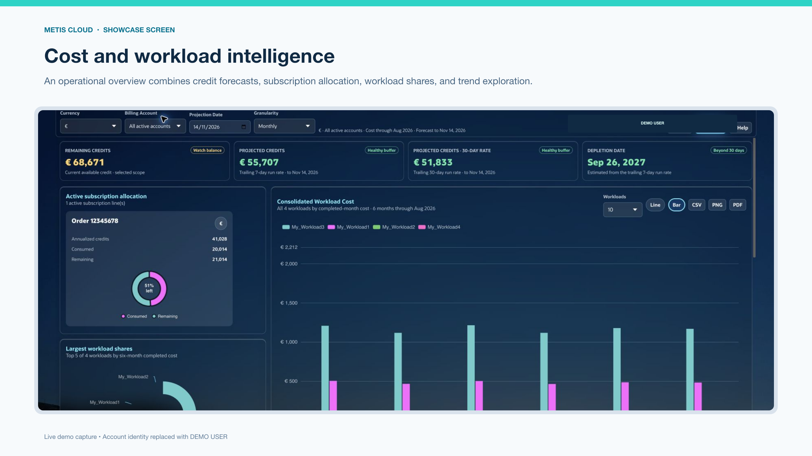

# MetisCloud

License: [PolyForm Noncommercial 1.0.0](LICENSE) (Source Available)

Understand your Oracle Cloud costs, workloads and resources in one application.

[Get started](docs/README.md) · [Page overview](docs/pages-and-help.md) ·
[FAQ](docs/faq.md) · [Security](SECURITY.md) · [License](LICENSE)

MetisCloud is an Oracle APEX application for teams managing Oracle Cloud
Infrastructure (OCI). It brings cost and usage reports together with resource
inventory, workload budgets, subscription credits and collected availability
metrics. FinOps analysts can investigate spending changes, workload owners can
review their assigned scope, and administrators can manage collection and access.

You install it in your Oracle Autonomous Database with managed APEX. Optional
OCI Generative AI features provide conversational analysis and page-help assistance.

## See it in action

[Watch the product overview](https://gitlab.com/andreT30/metiscloud/-/raw/main/docs/media/metiscloud-product-overview.mp4?ref_type=heads)
or [download the MP4](https://github.com/andreT30/metiscloud/raw/refs/heads/main/docs/media/metiscloud-product-overview.mp4)
(MP4, 4 minutes 50 seconds, approximately 25 MiB).
The tour uses owner-approved demo data and covers dashboards, Analysis, Metis Bot,
OCI Tools, topology, availability and administration. The watch link opens the
MP4 directly in your browser. You can also download it for local playback or
browse the [screenshots](docs/media/README.md#screenshots).
The recording is from
September 2026; current guides and in-app help take precedence over older labels.

## What you can do

- Investigate cost and usage by service, compartment, workload, resource and period.
- Track subscription credits, spending trends, forecasts and workload budgets.
- Explore OCI inventory, tags, compartment hierarchies and resource relationships.
- Save reporting views and download results for further analysis.
- Review collected availability metrics with their coverage and freshness limits.
- Ask questions of approved datasets or reference files through the optional Bot.
- Manage user access, data loads, schedules and operational diagnostics.

Pages and data depend on each user's role and workload assignments. Reporting
supports operational analysis; validate important financial conclusions against
provider reports and your accounting controls.

## Get started

The supported deployment path is Oracle Autonomous Database with managed APEX,
using a public or private endpoint. You need OCI IAM and database administration
access for preparation, plus Bash and Oracle SQLcl on the installer workstation.

1. [Install MetisCloud](docs/installation.md): choose the database, prepare
   networking and IAM, install SQLcl, verify the distribution and run INITIAL.
2. [Set up and configure MetisCloud](docs/configuration.md): sign in, complete
   Setup, load data, verify a report and grant user access. AI and email are optional.

For an existing installation, follow [Upgrade](docs/upgrade.md), including the
DBA-managed schema backup and configuration replacement rules. Do not run INITIAL
over an installed application schema.

## Documentation

Start at the [documentation guide](docs/README.md) for an ordered reading path.

| I want to… | Guide |
| --- | --- |
| Prepare infrastructure and install the application | [Install MetisCloud](docs/installation.md) |
| Load my first data or change application settings | [Set up and configure MetisCloud](docs/configuration.md) |
| Understand administrators, groups and workload access | [Access control](docs/access-control.md) and [security responsibilities](docs/security.md) |
| Find a page or learn its controls | [Page overview and in-app help](docs/pages-and-help.md) |
| Analyse costs and use reports | [User guide](docs/usage.md) |
| Operate and maintain the application | [Administration](docs/administration.md) and [assistant administration](docs/assistant-administration.md) |
| Update, restore or remove an installation | [Upgrade](docs/upgrade.md), [backup and recovery](docs/backup-and-recovery.md), [removal](docs/recovery-and-removal.md) |
| Resolve a problem | [FAQ](docs/faq.md) and [troubleshooting](docs/troubleshooting.md) |

## Distribution and release status

This repository contains the supplied application bundle, target-side deployment
tool, documentation and approved demo media. Application and database
definitions needed for installation are packaged inside the bundle; the private
development repository, deployment credentials and runtime data are not included.

[VERSION](VERSION) identifies the bundled application version.
[CHANGELOG.md](CHANGELOG.md) records distribution changes, starting with the
first public baseline. Verify [reporting](docs/configuration.md#verify-the-first-load)
and [user access](docs/configuration.md#give-other-users-access) before admitting users.

## Security and support

Operators control OCI IAM, database access, APEX authentication, application roles,
network restrictions, backups and optional AI data sharing. Review the
[security guide](docs/security.md) before admitting users.

Report vulnerabilities through [SECURITY.md](SECURITY.md). Do not post credentials,
customer information or raw logs in public issues. For ordinary defects and
documentation suggestions, use [GitHub Issues](https://github.com/andreT30/metiscloud/issues)
or [GitLab Issues](https://gitlab.com/andreT30/metiscloud/-/issues) on your preferred host.
See [CONTRIBUTING.md](CONTRIBUTING.md) before proposing a change.

## License

MetisCloud is distributed under the [PolyForm Noncommercial License 1.0.0](LICENSE).
This repository does not grant commercial-use rights. Read the license before
deploying; public availability does not make it an unrestricted open-source license.
[Third-party notices](THIRD_PARTY_NOTICES.md) cover included and referenced components.

MetisCloud is an independent project, not an official Oracle product. Oracle
product names and marks belong to their respective owners.
