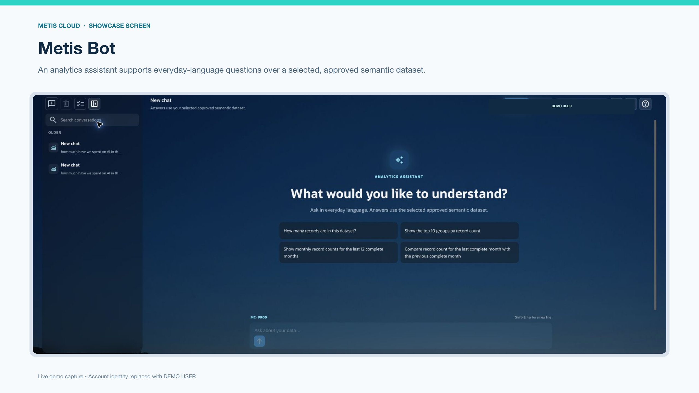

# Use MetisCloud

After an administrator completes [Setup](configuration.md#complete-setup) and
assigns your access, start with a reporting period covered by a successful load.

For a high-level directory and the **?** help button or page-help widget, start
with [Pages and in-app help](pages-and-help.md).

Start with a question and a completed reporting period. Confirm currency,
billing account, workload and data freshness before comparing numbers.
MetisCloud supports operational FinOps analysis; confirm important financial
conclusions against provider reports and your accounting controls.

| What you want to do | Open |
| --- | --- |
| Review credits, forecasts and spend concentration | Home |
| Explain a cost change or compare consumption | Analysis |
| Inspect resources, compartments and relationships | OCI Tools |
| Repeat a saved cost view | My Reports |
| Review collected availability evidence | Availability Metrics |
| Ask about approved data or reference material | MetisCloud Chat / Metis Bot |
| Find completed files and budget alerts | Notification bell / My Notifications |

Pages and data depend on your role, individual workload assignments and enabled
features. If you see Awaiting workload assignment, ask the administrator to
activate your assignments. Do not use another person's account.

## Home: credits and workload spend

Select currency and billing account first. The projection date affects forecasts,
not historical reporting periods. Read the 7-day and 30-day consumption-rate
forecasts separately; they can differ after a recent cost change. Remaining
credits and estimated depletion are forecasts, not an invoice.

The subscription cards and six completed months show the broader position.
Top-workload charts group smaller workloads under Other. Select a workload to
inspect its monthly or recent weekly pattern. The workload explorer starts with
the last 30 days; completed months and rolling periods have different boundaries.
Recent reporting stops two days before today.

CSV, PNG and PDF actions apply to their selected view. The extended Excel
comparison includes totals and detail for its comparison frames; check those
periods before comparing it with an on-screen chart.

A failed or unavailable component is not a zero value. Reset filters and retry
once, then ask the administrator to inspect ingestion if the problem persists.

## Analysis: investigate a change

1. Select currency, billing account, workload, daily/weekly/monthly granularity
   and the period. The latest selectable date is two days before today.
2. Add Advanced Filters only as needed: environment, region, tenancy, service,
   charge or resource. Resource search returns a bounded list; refine the text
   if the resource is not among the first 100 results.
3. Use Overview to locate movement. Review category and compartment detail
   with the full compartment path so similarly named compartments stay distinct.
4. Use Columns where offered to stage Charge Description or SKU, then Apply.
   Cancel retains the current selection.
5. Open Usage Trends for current and previous values. Its selected end date
   anchors comparison windows. Read the exact numbers alongside percentage
   changes; the chart shows the largest nonzero changes, not every row.

Budget cards need one selected workload and a budget in the same currency.
An environment filter makes the workload-wide comparison unavailable.
The 730-hour projection uses the recent 30-day cost rate. Missing budget or
comparison data does not mean zero.

### Compare usage quantities

Open Daily Usage with the intended scope. Read category, charge description, SKU
and unit together. Do not add CPU time, storage and requests into one quantity.
A missing comparison is different from zero usage.

Excel downloads the filtered report. PivotTable produces a workbook with
rearrangeable fields and an included Source Data sheet. Refreshing that workbook
uses its included data, not the live application. Keep mixed-unit grand totals
off unless the chosen fields make them meaningful.

### Download a report file

Use **Create Export → Scope → Shape → Review** for a background CSV/JSON file.
Include Usage Unit with Usage Quantity and Pricing Unit with Pricing Quantity.
Submit once, then follow My Exports or the notification bell.

Completed files remain available for seven days. Download to approved storage
if needed longer. An email link requires sign-in. A failed request is not a
usable partial result. Only terminal requests can be deleted; deletion removes
the stored file and linked notification permanently. Queued/running work is
protected from that deletion.

## OCI Tools: inventory and relationships

In OCI Inventory, stage filters, Apply, then select a resource for its identity,
placement, governance and tags. A compartment selection matches that compartment
exactly; it does not automatically include descendants. Path text searches and
hierarchy selections can represent different scopes.

CSV/JSON downloads cover the filtered inventory through bounded batches.
They contain operational identifiers and metadata, so store them privately.

Analytics provides Estate overview, Cost and Topology. Start with a finding and
open its evidence. Inventory and Analytics filters are independent. In Topology,
choose direction/depth or Full detail and read the coverage notices. Traversal
uses the loaded snapshot; missing edges with partial collection do not prove
that resources are unrelated.

Policies and Compartments show searchable hierarchy and details. **Load Policies**
starts ingestion and requires administrator permission. It is not a display
refresh. Ask an administrator to investigate missing collection before starting
another load.

## My Reports: repeat a view

Select a saved report, period, dates and granularity, then Apply. The chart,
summary and detail use that reporting boundary. New report/Add workload, where
authorized, combines compartment, configured-tag or saved-workload scope within
your current access.

Give reports a recognizable purpose and recheck definitions after workload or
tag changes. Table search narrows loaded rows without rerunning the report.
A report workload does not change OCI resources or grant access to other data.

## Availability Metrics: interpret the evidence

Choose region, workload, namespace and a 7-, 30-, 60-day or custom window.
Custom windows are limited to 89 days and 20,000 intervals.

The headline is duration-weighted across complete intervals ending at least two
days ago. Missing metrics count as zero availability in that calculation;
the latest two days are excluded. Red intervals indicate absent-metric evidence
and amber intervals indicate recent collection progress.

This view does not prove an underlying resource outage or application
reachability. Distinguish measured availability, telemetry coverage and the
headline calculation. Stale or failed inventory also limits interpretation.
Use PNG/PDF for the selected charts and retain the scope/coverage explanation
when sharing them.

## Chat and page help

Select the intended approved dataset for data questions. Ask one question with
a period and grouping, such as "Show cost by service for the last complete
month." Answer clarification questions, then inspect the scope, explanation,
table and chart. Verify important totals in Analysis. A suggested question is
not proof that its data has been loaded.

Generic assistant file search depends on the reference files approved by your
administrator. Check any cited material before relying on the answer. Do not
enter secrets or information prohibited by your organization's AI policy.

Use follow-ups for the same topic and start a new conversation when changing
subjects. Report incorrect answers with a sanitized request/run reference.
The administrator can inspect Bot Logs; do not put raw prompts/results in a
public issue.

The page-help widget explains the current page. Its conversation is kept in
browser memory and disappears on refresh or navigation. Record a displayed
support reference such as WID-123 before leaving. It does not grant
administrative access or certify results.

## Notifications

My Notifications shows your own recipient records. Opening a notification marks
it read; Mark all read handles the displayed notification workflow without
resolving the underlying condition. Unread and active-budget states can overlap.

The bell shows one combined count: active budget alerts (even if read) plus unread
non-budget notifications, with each notification counted once. Amber means only
budget alerts are counted; red means at least one unread non-budget notification
is also present. The history table has its own count, so it need not match the bell.

An active budget alert cannot be deleted until its condition clears. Reading it
does not clear the budget condition. Deleting an eligible notification is
permanent. The list is bounded to 500 entries and prioritizes active budgets;
a table count is not an unlimited audit history.

## Empty results and errors

Check period, currency and workload first, then clear unnecessary filters.
Ask the administrator to compare the latest successful load with source report
availability. Inventory and billing use different sources, so an existing
resource need not yet have cost in the chosen period.

A page error is different from a valid empty result. Do not repeatedly queue
jobs to fix a display problem. Follow [Troubleshooting](troubleshooting.md).

The [five-minute product tour](media/metiscloud-product-overview.mp4) uses approved
demo data. It was recorded in September 2026; current labels and workflows take
precedence over the recording.
